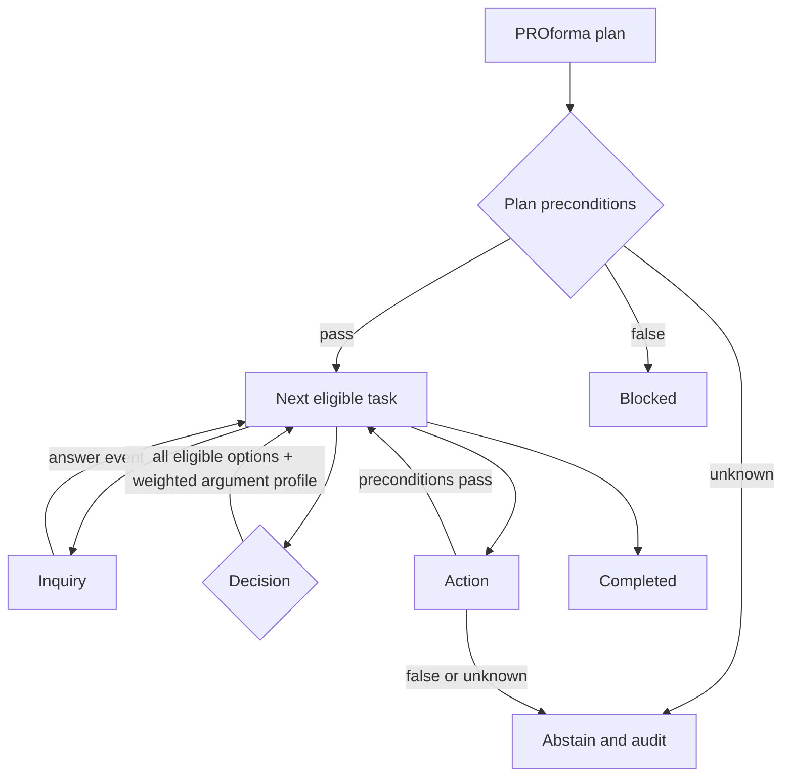

# 2. PROforma model library

**Only executable logic:** `HSPTL-PROforma-Subset/1.1`. All pathway sequencing, decision eligibility, appraisal task flow, template preconditions, routing predicates and guards use the same bounded runtime. The model library stores JSON PROforma task/predicate structures; it does not introduce decision tables or a second executable format.

## Library map

| Folder | Model | Purpose |
|---|---|---|
| `models/pathways/` | `case_review.json`, `reasoned_choice.json` | Educational case review and additive argumentation choice pathway |
| `models/appraisal/` | `grade_domain_appraisal.json` | GRADE domain-by-domain human appraisal workflow |
| `models/templates/` | `evidence_linked_assertion_preconditions.json` | Assertion, appraisal, rights and source-span preconditions |
| `models/routing/` | `workspace_eligibility.json` | Canonical object/fresh projection/user eligibility |
| `models/guards/` | `assertion_lineage_guard.json` | Evidence-lineage guard plan |

The catalogue endpoint `GET /api/v4/logic/models` reports which files pass the production plan validator. The bounded task vocabulary is `plan`, `decision`, `action`, `inquiry`; unsupported operators or missing information remain unknown and abstain. For the small set of rules classified `z3_required`, the solver adapter compiles the same PROforma expression tree over declared symbolic references; it does not accept a parallel rule syntax.

## Visual notation

`decision` options are exposed only if their `when` predicates are proven true. If any competing option is undecidable, the runtime abstains rather than silently filtering the unknown option. A false precondition blocks; an unknown precondition abstains.

## GRADE subset boundary

`grade_domain_appraisal.json` prompts for risk of bias, inconsistency, indirectness, imprecision and publication/reporting bias. It records each reviewer-selected domain response and rationale, then submits the record for a human certainty panel. It does **not** calculate a final certainty level or compress the GRADE domains into a score. The fixture does not replace EvidenceGRADEr or official GRADE guidance.

## PheKB conversion boundary

PheKB phenotype artifacts can include human-readable algorithm documents, data dictionaries and site-specific implementation information. A curator must map criterion definitions to the supported PROforma predicate subset before the conversion adapter accepts them. `phekb_phenotype_to_proforma()` rejects executable code strings and only accepts explicit boolean/PROforma expressions.

Two fixture tracks are included:

- `phekb_style_case_001.proforma.json` is synthetic and tests the generic curator-normalization adapter.
- `phekb_type2_diabetes_ehr_plus.proforma.json` is a source-attributed, rule-level re-expression of the PheKB Type 2 Diabetes (T2D) preferred `t2d_dprism_ehr_plus_1` case path and its universal control path. It includes age/T1D exclusion, the ICD/medication/insulin branches, the abnormal fasting glucose/HbA1c lab branch, the non-insulin-medication branch without T2D diagnosis, self-reported T2D, and the published control constraints. Its input values are synthetic; no patient records or site-specific code tables are included. See the [PheKB source algorithm](https://phekb.org/sites/phenotype/files/Type%202%20Diabetes.pdf).

The alternative EHR-only algorithm, local code mappings, medication dictionaries and data-extraction procedures are not included. The fixture is for deterministic software testing and educational inspection only; it is not a validated clinical phenotype implementation.

## One debugger

`debugger.py` is the single read-only debugger. It runs the production `evaluate()` predicate engine, reports the first next task, eligible options, trace and first blocker/abstention, and returns `writes: 0`. Invoke through `POST /api/v4/logic/debug` with `{ "plan": ..., "facts": ..., "answers": ... }`. It is not a second interpreter.

## Weighted argumentation (G)

Each PROforma `decision` option may declare `arguments[]`. An argument has a stable `id`, `polarity` (`for` or `against`), finite non-negative `weight`, optional PROforma `when`, a display `label`, and optional `evidence` / `source_events` references. Active arguments are additive and independent: `support_force = sum(for weights)`, `opposition_force = sum(against weights)`, and `net_force = support_force - opposition_force`. Preference order sorts by net force, then support force, then candidate id for deterministic ties. An `abstain` argument contributes zero force and remains visible with its reason. Any unknown condition abstains the decision. Preference is indicative only; enactment returns all eligible options and their profiles, records only the user's selected option, and never auto-selects.

`models/pathways/reasoned_choice.json` is a minimal demonstrator. The same PROforma expression tree feeds the optional in-process SMT adapter for symbolic consistency and counterfactual checks.
